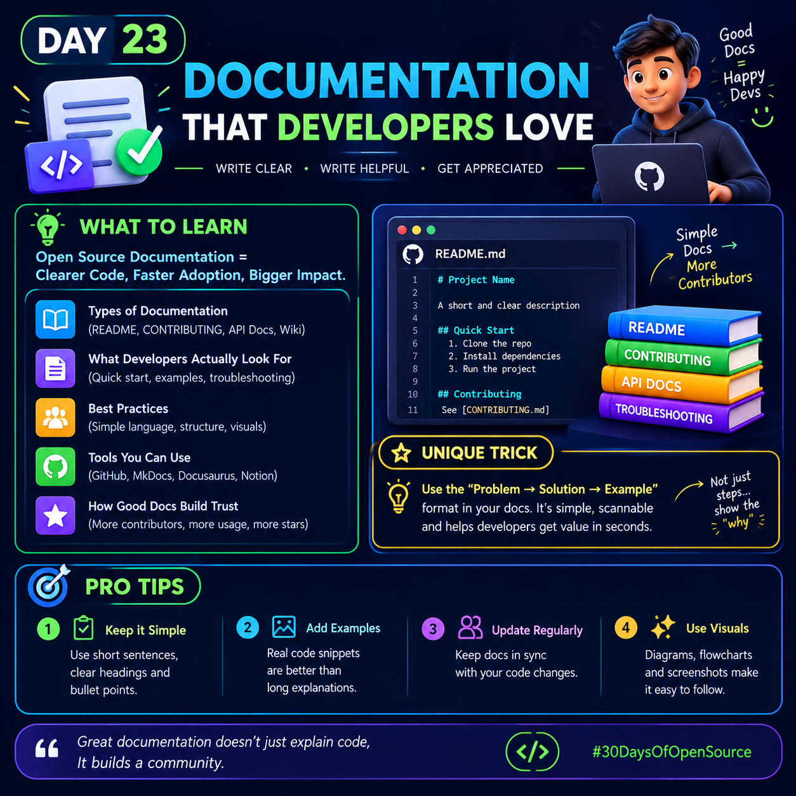

# Day 23: Documentation That Developers Love 

<p>
  
</p>

Good documentation helps developers understand a project, set it up quickly, and start contributing without confusion.

## 1. What Is Open Source Documentation?

Open source documentation explains how a project works, how to use it, and how others can contribute to it.

**Good documentation = Clear Code + Faster Adoption + Bigger Impact**

## 2. Types of Documentation

- **README.md:** Introduces the project and explains how to install and use it.
- **CONTRIBUTING.md:** Explains how developers can contribute to the project.
- **API Documentation:** Describes API endpoints, parameters, requests, and responses.
- **Wiki:** Provides detailed guides, tutorials, and project knowledge.
- **Troubleshooting Guide:** Helps users identify and solve common problems.

## 3. What Do Developers Look For?

Developers usually want to know:

- What does this project do?
- Why should I use it?
- How do I install and run it?
- Can I see a working example?
- How do I fix common errors?
- How can I contribute?

Answering these questions clearly makes your project easier to understand and use.

## 4. The Unique Trick: Problem → Solution → Example 💡

When documenting a feature or explaining an error, follow this simple structure:

1. **Problem:** Explain what the developer wants to solve.
2. **Solution:** Show the steps needed to solve it.
3. **Example:** Provide working code or a practical demonstration.

### Example

**Problem:** Your Python application cannot connect to an API.

**Solution:** Check the API URL, authentication credentials, and network connection.

**Example:**

```python
import requests

url = "https://api.example.com/health"

response = requests.get(url, timeout=10)

print(response.status_code)
```

This example demonstrates an HTTP request. The URL is a placeholder, so replace it with a real endpoint before running the code.

**Why this trick works:** Developers can understand the issue, find the solution, and apply it without reading a long explanation first.

## 5. Best Practices for Better Documentation

### Keep It Simple
Use short sentences, meaningful headings, and bullet points.

### Add Practical Examples
Show real commands, sample requests, expected outputs, and code snippets.

### Keep It Updated
Update the documentation whenever installation steps, APIs, or features change.

### Use Visuals
Add diagrams, screenshots, and flowcharts when they make complex concepts easier to understand.

### Explain Common Errors
Describe what went wrong, why it happened, and how to fix it.

## 6. Useful Documentation Tools

- **GitHub:** Store documentation alongside your source code.
- **MkDocs:** Build documentation websites using Markdown.
- **Docusaurus:** Create documentation websites for software projects.
- **Markdown:** Write clean, readable documentation using simple formatting.

## 7. How Good Documentation Builds Trust

Clear documentation can help a project:

- Attract new contributors.
- Reduce repeated questions.
- Improve onboarding.
- Make features easier to use.
- Build a stronger developer community.

## Day 23 Challenge 🎯

Choose an open source project and improve one small part of its documentation.

You could fix an unclear installation step, add a missing example, explain a confusing error, or improve a section of its README.

Before submitting a change, check that your instructions are accurate and that any code examples work as intended.

## Final Thought

**Great documentation doesn't just explain code. It helps people understand, use, and contribute to it.**

#30DaysOfOpenSource #OpenSource #GitHub #Documentation #WebDevelopment #Codewalalife