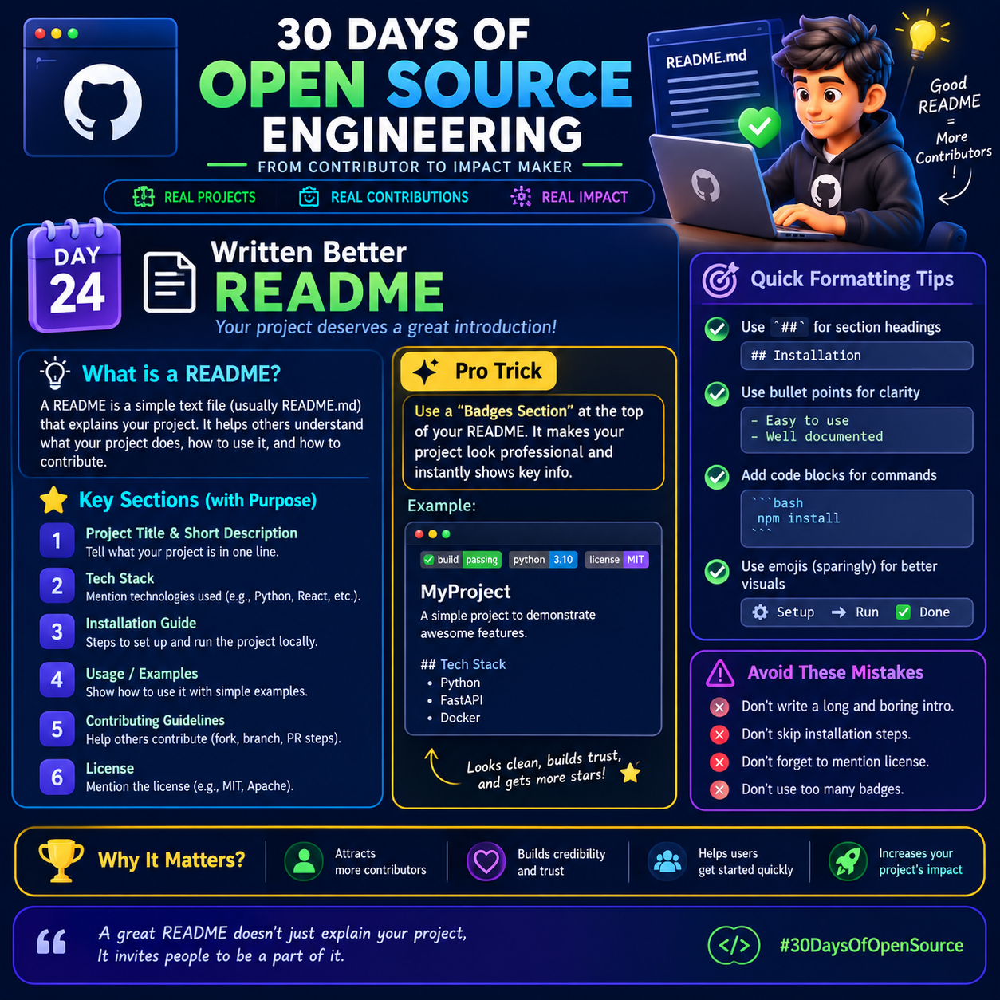

# Day 24: Writing Better README 📘
<p>
  
</p>

## 30 Days of Open Source Engineering
**From Contributor to Impact Maker**

A great README is the first step toward making your open-source project easy to understand, use, and contribute to.

### 💡 What Is a README?
A README is a simple text file, usually named `README.md`, that explains your project. It helps people understand what your project does, how to use it, and how to contribute.

### ⭐ Key Sections of a Good README

**1. Project Title & Short Description**
- Explain what your project does in one clear sentence.

**2. Tech Stack**
- Mention the technologies used, such as Python, React, FastAPI, or Docker.

**3. Installation Guide**
- Provide step-by-step instructions to set up and run the project locally.

**4. Usage / Examples**
- Show users how to use your project with simple examples.

**5. Contributing Guidelines**
- Explain how others can contribute, including forking, creating branches, and submitting pull requests.

**6. License**
- Clearly mention the license, such as MIT or Apache 2.0.

### 🚀 Pro Trick: Add a Badges Section
Place a small **Badges Section** near the top of your README to display useful project information at a glance, such as build status, test coverage, programming language, version, and license.

Example:

- Build: Passing
- Language: Python 3.10
- License: MIT

Badges make important project details easier to notice and can help your project look more organized and professional.

### 🛠️ Quick Formatting Tips

**1. Use headings for structure**
```markdown
# My Project
## Installation
### Usage
```

**2. Use bullet points for clarity**
```markdown
- Easy to use
- Well documented
- Beginner friendly
```

**3. Add code blocks for commands**
````markdown
```bash
npm install
```
````

**4. Use emojis sparingly**
```markdown
⚙️ Setup → ▶️ Run → ✅ Done
```

### ⚠️ Avoid These Mistakes
- Don't write a long, boring introduction.
- Don't skip installation steps.
- Don't forget to mention the license.
- Don't overload your README with badges.

### 🏆 Why Does a Good README Matter?
- Attracts more contributors.
- Builds credibility and trust.
- Helps users get started quickly.
- Increases your project's reach and impact.

### 💬 Remember
*A great README doesn't just explain your project; it invites people to be a part of it.*

**#30DaysOfOpenSource**

**Day 24 Challenge:** Pick one of your GitHub projects and improve its README by adding a clear description, installation instructions, a usage example, contribution guidelines, and license information.