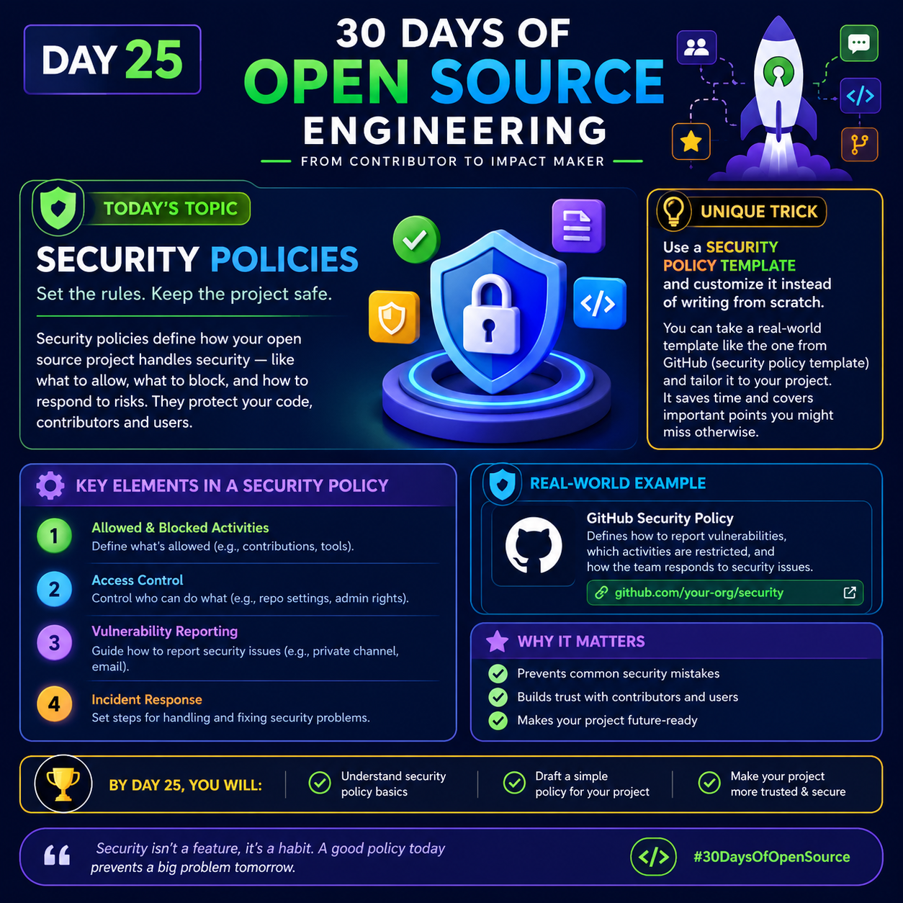

# 🛡️ Day 25: Security Policies

<p>
  
</p>
## 30 Days of Open Source Engineering
**From Contributor to Impact Maker**

**Today's Topic:** Security Policies  
*Set the rules. Keep the project safe.*

Security policies define how an open-source project handles security, including what activities are allowed, what should be restricted, and how to respond to security risks. They help protect code, contributors, and users.

---

## 💡 Unique Trick: Start with a Security Policy Template

Instead of writing a security policy from scratch, start with a trusted template and customize it for your project.

For example, review GitHub's security policy guidance and adapt it to your repository's needs.

**Why this works:**
- Saves time when creating your first policy.
- Helps cover important security requirements.
- Makes vulnerability reporting instructions clear.
- Gives contributors a consistent process to follow.

**Important:** Always customize the template. A copied policy is useful only when it reflects your project's actual security practices.

---

## 🔐 Key Elements of a Security Policy

### 1. Allowed and Blocked Activities
Define what contributors can do and which activities are restricted.

Examples:
- Specify acceptable contribution practices.
- Document prohibited actions.
- Explain relevant repository rules.

### 2. Access Control
Define who can access and manage project resources.

Examples:
- Assign appropriate repository permissions.
- Limit administrative access.
- Review permissions regularly.
- Enable security protections where appropriate.

### 3. Vulnerability Reporting
Explain how users and researchers should report security vulnerabilities safely.

Examples:
- Provide a private reporting channel.
- Explain what information to include in a report.
- Tell reporters what response they can expect.
- Avoid asking people to publish sensitive vulnerability details in public issues.

### 4. Incident Response
Describe how maintainers will handle reported security problems.

Examples:
- Review and assess the report.
- Prioritize the severity of the issue.
- Develop and test a fix.
- Coordinate disclosure and release of the fix.
- Document lessons learned.

---

## 🌐 Real-World Example: GitHub Security Policy

GitHub repositories can include a `SECURITY.md` file that explains how to report security vulnerabilities.

A security policy can describe:
- Supported versions.
- Private vulnerability reporting methods.
- The information needed to investigate a report.
- How the maintainers handle security issues.

**Example repository file:**

`SECURITY.md`

```markdown
# Security Policy

## Supported Versions

Security updates are provided for the versions
listed below.

| Version | Supported |
|---------|-----------|
| 2.x     | Yes       |
| 1.x     | No        |

## Reporting a Vulnerability

Please report security vulnerabilities privately
using the repository's configured security reporting
channel.

Include:
- A description of the vulnerability
- Steps to reproduce the issue
- Potential impact
- A suggested fix, if available

Please do not disclose the vulnerability publicly
until the maintainers have had a reasonable
opportunity to investigate and address it.
```

**Note:** This is an illustrative template. Replace the version information, reporting channel, and response commitments with details that accurately reflect your project.

---

## ⭐ Why Security Policies Matter

- ✅ Prevent common security mistakes.
- ✅ Build trust with contributors and users.
- ✅ Make vulnerability reporting safer and clearer.
- ✅ Help maintainers respond consistently.
- ✅ Improve the long-term security of a project.

---

## 🎯 By Day 25, You Will Be Able To

- Understand the basics of security policies.
- Identify the essential sections of a security policy.
- Create a simple `SECURITY.md` file.
- Make your open-source project more trustworthy and secure.

---

## 🚀 Practical Challenge

Choose an open-source repository you maintain or are authorized to improve.

1. Check whether it already has a `SECURITY.md` file.
2. Identify how security vulnerabilities should be reported.
3. Review the supported versions and response instructions.
4. Draft or improve the policy to match the project's actual practices.
5. Ask the maintainers to review your changes before submitting a pull request.

**Remember:** Never invent a security contact or promise a response time that the project cannot meet.

---

> Security isn't a feature; it's a habit. A good policy today can help prevent a bigger problem tomorrow.

**#30DaysOfOpenSource #Day25 #SecurityPolicies #CyberSecurity #OpenSource #GitHub #SecureCoding #DevSecOps #SoftwareEngineering**
