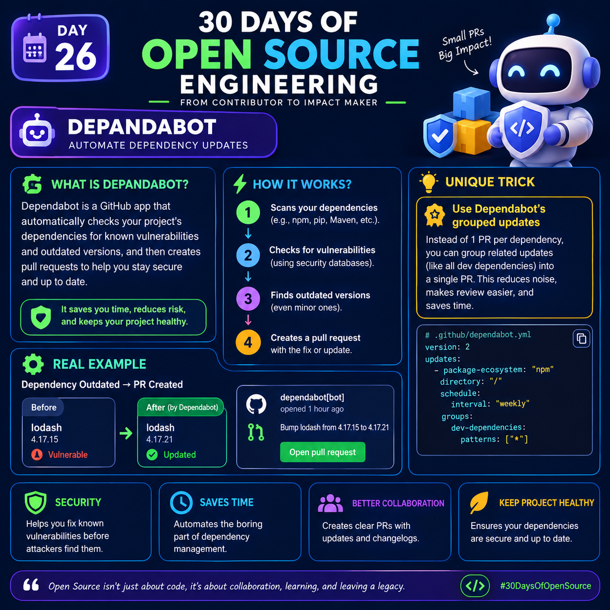

# Day 26: Dependabot — Automate Dependency Updates

<p>
  
</p>
## 1. What Is Dependabot?

Dependabot is a GitHub tool that helps developers keep their project dependencies updated and secure. It checks the libraries and packages a project uses, identifies known security vulnerabilities, and detects newer versions.

When an update is available, Dependabot can create a pull request (PR) with the proposed change so developers can review and merge it.

For example, if your Node.js project uses an outdated version of Lodash, Dependabot can suggest a newer version and open a pull request to update it.

**Why is it useful?**
- Helps identify known vulnerabilities in dependencies.
- Reduces the manual work involved in checking for updates.
- Makes dependency updates easier to review.
- Helps maintain a healthier and more secure codebase.

## 2. How Does Dependabot Work?

Dependabot provides two important capabilities: dependency security updates and version updates.

### Step 1: Scans Your Dependencies

Dependabot checks the dependencies declared in supported package manifests and lockfiles, such as `package.json` and `package-lock.json` in many npm projects.

It can also work with supported ecosystems such as Python's pip, Maven, and others.

### Step 2: Checks for Known Vulnerabilities

Dependabot security updates can use GitHub's vulnerability information to identify dependencies affected by known security advisories.

For example, a package might have a vulnerability that affects a particular range of versions.

Dependabot may propose an update to a version that addresses the vulnerability, when a suitable update is available.

### Step 3: Finds Available Versions

Dependabot version updates can check for newer dependency versions according to your configuration.

You can configure how frequently it checks for updates, which package ecosystems it monitors, and which directories it manages.

### Step 4: Creates a Pull Request

When an appropriate update is available, Dependabot can open a pull request containing the proposed dependency changes.

The PR can be reviewed, tested, and merged like any other code change.

**Important:** Dependabot does not guarantee that every update is safe or compatible. Always review the changes and run your project's tests before merging.

## 3. A Practical Example: Updating Lodash

Imagine your project uses an outdated Lodash version.

**Before the update:**

- Package: `lodash`
- Installed version: `4.17.15`
- Status: An older version that may be affected by known vulnerabilities.

**After Dependabot proposes an update:**

- Package: `lodash`
- Proposed version: `4.17.21`
- Status: A newer version that addresses certain known issues affecting earlier versions.

Dependabot can create a pull request that updates the dependency files.

The developer should then:
1. Read the pull request description.
2. Review the version and lockfile changes.
3. Check the changelog for breaking changes.
4. Run automated tests and security checks.
5. Merge the PR only after the update passes the project's review process.

The exact version you should use depends on the vulnerability, compatibility requirements, and currently available releases.

## 4. Unique Trick: Use Grouped Dependency Updates

One useful way to reduce dependency-update noise is to configure Dependabot to group related updates into fewer pull requests.

Without grouping, a project with many development dependencies might receive numerous separate update PRs.

With grouping, compatible updates that match your configuration can be combined into a single pull request.

### Example Configuration

Create or update the following file in your GitHub repository:

`.github/dependabot.yml`

```yaml
version: 2

updates:
  - package-ecosystem: "npm"
    directory: "/"
    schedule:
      interval: "weekly"

    groups:
      development-dependencies:
        dependency-type: "development"
        patterns:
          - "*"
```

### Explanation of the Configuration

- `version: 2` — Specifies the Dependabot configuration format.
- `updates` — Defines the dependency update rules.
- `package-ecosystem: "npm"` — Enables update management for npm dependencies.
- `directory: "/"` — Tells Dependabot to look for the npm manifest and lockfile in the repository root.
- `schedule.interval: "weekly"` — Requests weekly dependency update checks.
- `groups` — Defines rules for combining matching updates.
- `dependency-type: "development"` — Targets development dependencies, such as many testing and linting tools.
- `patterns: ["*"]` — Matches all development dependency names within this group.

**Why this trick helps:** Grouping development dependency updates can reduce the number of PRs your team needs to review.

However, grouping is not always the best choice. If a project has strict testing requirements or needs to isolate individual changes, separate pull requests may be easier to troubleshoot.

## 5. Security Updates vs. Version Updates

These two features are related, but they serve different purposes.

### Dependabot Security Updates

Security updates focus on dependencies affected by known vulnerabilities. When GitHub identifies an eligible security update, Dependabot can open a pull request proposing a fix.

### Dependabot Version Updates

Version updates focus on keeping dependencies current, including updates that do not necessarily fix a known vulnerability.

For example, Dependabot might propose a newer version of a testing library because a new release is available.

**Remember:** Security updates help address known vulnerabilities, while version updates help keep dependencies up to date.

## 6. Benefits of Dependabot

### Better Security

Dependabot can help developers identify and address known dependency vulnerabilities before they remain unnoticed for long periods.

### Saves Time

Automated checks and pull requests reduce the need to manually monitor every dependency.

### Better Collaboration

Pull requests provide a clear place for teammates to review updates, discuss potential problems, and check test results.

### Healthier Projects

Regular dependency maintenance can reduce the accumulation of outdated packages and make long-term maintenance easier.

## 7. Best Practices for Using Dependabot

- Enable Dependabot security updates where appropriate.
- Configure version updates for the ecosystems your project uses.
- Use grouped updates when they fit your testing and review workflow.
- Enable automated tests for dependency update pull requests.
- Review changelogs and release notes for significant upgrades.
- Avoid blindly merging every automated PR.
- Keep your dependency manifests and lockfiles committed to version control.
- Use branch protection and required checks for important repositories.
- Investigate repeated failures instead of continually dismissing update PRs.

## 8. How to Set It Up on GitHub

1. Open your GitHub repository.
2. Navigate to the repository's Settings.
3. Find the security configuration section, usually under Code security or Security.
4. Enable the available Dependabot security features that suit your repository.
5. Add a `.github/dependabot.yml` file to configure version updates.
6. Commit the configuration file.
7. Check the repository's pull requests for proposed dependency updates.
8. Review, test, and merge appropriate updates.

The exact settings and available features can vary depending on the repository and GitHub configuration.

## 9. Key Takeaway

Dependabot automates important parts of dependency maintenance by checking for updates and proposing changes through pull requests.

The real value comes from combining automation with good engineering practices: use Dependabot to identify updates, use tests to check compatibility, and use code review to decide what should be merged.

**Day 26 takeaway:** Automate dependency maintenance, review every important change, and keep your open-source project secure and maintainable.

#30DaysOfOpenSource #Dependabot #GitHub #OpenSource #CyberSecurity #SoftwareEngineering #DevSecOps