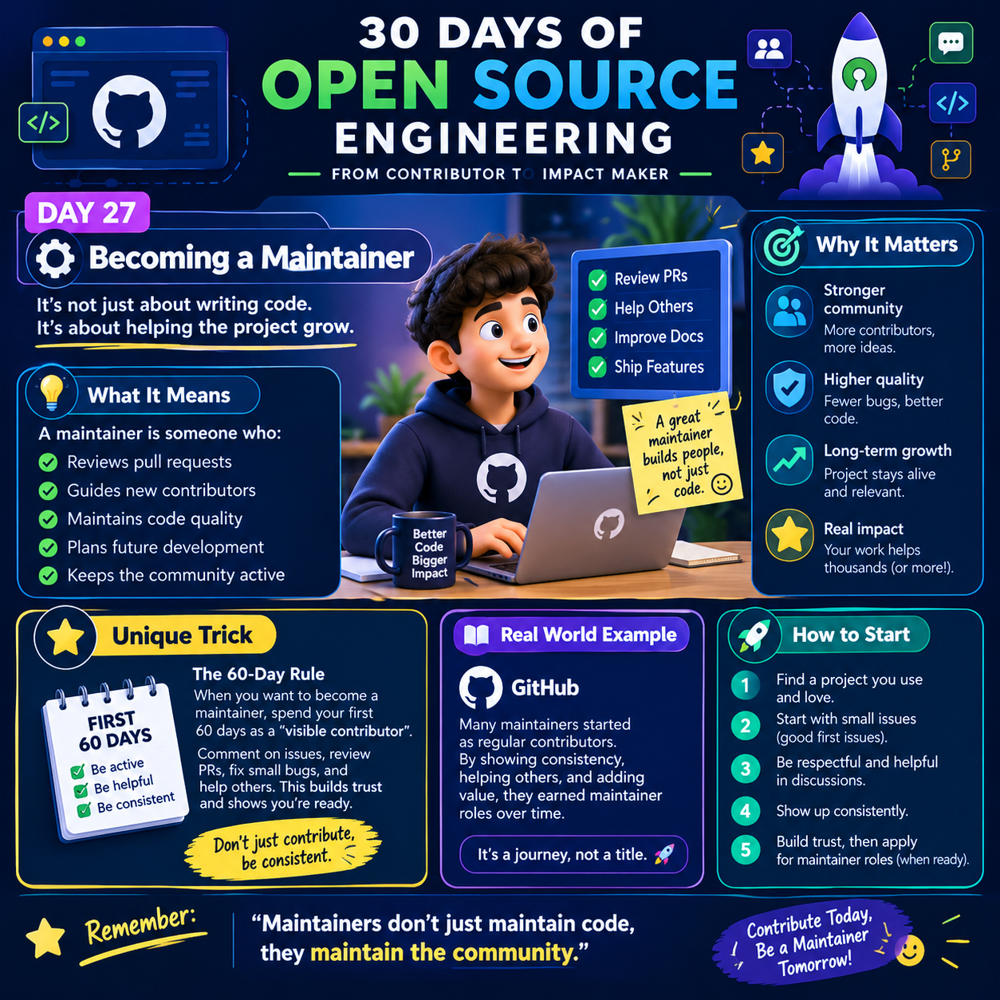

# 30 Days of Open Source Engineering
## From Contributor to Impact Maker

  

# 🟣 Day 27: Becoming a Maintainer

> **It's not just about writing code. It's about helping the project grow.**

Becoming an open-source maintainer is an important step in a developer's journey. A maintainer helps a project stay reliable, secure, organized, and welcoming. This role goes beyond writing code: it includes reviewing contributions, supporting developers, managing releases, improving documentation, and guiding the community.

The goal is not simply to earn a title. It is to take responsibility for the long-term health of a project and help other contributors succeed.

---

## 1. 💡 What Is an Open-Source Maintainer?

An open-source maintainer is a person who helps manage and improve an open-source project. Depending on the project, maintainers may have permission to approve pull requests, merge code, publish releases, manage issues, or make decisions about the project's direction.

Not every maintainer has the same responsibilities. Small projects may have one person doing almost everything, while large projects may divide responsibilities among multiple maintainers.

### Key Responsibilities

- **Review pull requests:** Check submitted changes for correctness, readability, tests, and compatibility.
- **Guide contributors:** Explain project conventions, suggest improvements, and help newcomers understand the codebase.
- **Maintain code quality:** Encourage useful tests, consistent coding practices, and clear error handling.
- **Manage issues:** Reproduce bugs, identify priorities, label issues, and coordinate solutions.
- **Improve documentation:** Keep installation instructions, examples, FAQs, and contribution guidelines accurate.
- **Manage releases:** Prepare release notes, follow release procedures, and communicate changes to users.
- **Support security:** Follow responsible vulnerability-reporting procedures and help keep dependencies updated.
- **Build community:** Encourage respectful communication and make contribution processes welcoming.

---

## 2. 🎯 Why Does Becoming a Maintainer Matter?

### 👥 Stronger Community

A helpful maintainer makes it easier for people to participate. Clear guidance and constructive reviews help contributors learn and return to the project.

### 🛡️ Better Code Quality

Careful reviews, automated tests, and clear contribution standards reduce the chance of introducing regressions.

### 📈 Long-Term Sustainability

Projects need more than new features. They also need bug fixes, documentation updates, dependency maintenance, and release planning.

### 🌍 Real-World Impact

An improvement to a widely used library or tool can benefit many developers and organizations.

### 💼 Professional Growth

Maintaining a project can help demonstrate technical judgment, collaboration, communication, and ownership. These experiences may strengthen a developer's portfolio, although they do not guarantee a job.

---

## 3. ⭐ Practical Strategy: Your First 60 Days

**The principle: Don't just contribute — contribute consistently and help others.**

The following 60-day plan is a practical learning framework, not an official rule. Every project has its own expectations, and maintainership may take more or less time.

### 🗓️ Days 1–15: Understand the Project

- Choose a project you use or genuinely care about.
- Read its README, LICENSE, CONTRIBUTING.md, and Code of Conduct.
- Set up the development environment locally.
- Run the existing tests and explore the directory structure.
- Read recent issues and pull requests to understand project conventions.
- Learn how maintainers communicate and make decisions.

**Goal:** Understand how the project works before proposing major changes.

### 🗓️ Days 16–30: Make Useful Contributions

- Fix a small, reproducible bug.
- Improve unclear documentation.
- Add or update a test for an existing behavior.
- Follow formatting, testing, and commit-message conventions.
- Write a clear pull request description explaining the problem and solution.
- Respond politely to review feedback and update your changes.

**Goal:** Demonstrate that you can make focused, reviewable contributions.

### 🗓️ Days 31–45: Help the Community

- Help reproduce issues when you understand the problem.
- Answer beginner questions when you know the correct answer.
- Suggest missing tests or documentation improvements.
- Review code only when you have enough context to give useful feedback.
- Help contributors understand errors without being dismissive.
- Follow up on your own open pull requests.

**Goal:** Become useful beyond your own code submissions.

### 🗓️ Days 46–60: Demonstrate Ownership

- Take responsibility for a small task from investigation through completion.
- Help maintain documentation or tests in an area you understand.
- Learn the project's release and issue-triage processes.
- Communicate blockers early and finish what you commit to.
- Ask existing maintainers what additional responsibilities would be useful.
- If appropriate, express interest in helping with triage or other delegated tasks.

**Goal:** Build trust through reliable work, sound judgment, and collaboration.

**Important:** Do not expect maintainer access automatically after 60 days. Some projects require a long track record, formal nomination, governance approval, or specific permissions.

---

## 4. 🌍 Real-World Example: GitHub Open-Source Projects

Consider a developer who regularly uses a popular JavaScript library.

Initially, the developer notices a typo in the documentation and submits a small pull request. After learning the project's workflow, they fix a reproducible bug and add a regression test.

Later, they help another contributor understand a test failure and improve documentation for a confusing feature. Over time, existing maintainers notice that their contributions are thoughtful, consistent, and respectful.

The project might eventually invite the developer to help with issue triage or other responsibilities. If the developer continues to demonstrate good judgment, the project may consider granting additional permissions.

This is an illustrative example, not a claim about a particular GitHub repository.

**Key lesson:** Maintainer trust grows from demonstrated responsibility, not merely the number of pull requests submitted.

---

## 5. 🛠️ How to Start Becoming a Maintainer

### Step 1: Choose the Right Project

Look for a project that:
- Solves a problem you understand.
- Has clear contribution instructions.
- Has recent activity or a community that communicates with contributors.
- Offers issues suitable for your current skill level.

### Step 2: Learn Before Changing

Read the existing code, tests, documentation, and project conventions. Try to understand why the project works the way it does before proposing a solution.

### Step 3: Start Small

Good first contributions include:
- Correcting inaccurate documentation.
- Adding a missing test.
- Fixing a simple, reproducible bug.
- Improving an error message.
- Updating an example that no longer works.

Avoid choosing a large refactor simply because it looks impressive.

### Step 4: Communicate Clearly

A useful pull request should explain:
- What problem it solves.
- Why the change is needed.
- What implementation you chose.
- How you tested it.
- Any limitations or possible side effects.

### Step 5: Treat Feedback as Collaboration

Review comments are part of maintaining quality. Ask questions when feedback is unclear, explain your reasoning respectfully, and make requested changes when appropriate.

### Step 6: Help Without Overstepping

Do not merge your own changes, change project permissions, or make release decisions unless you have the necessary authorization. Follow the project's documented process.

### Step 7: Ask How You Can Help More

Once you have built a record of useful contributions, ask the existing maintainers whether you can help with issue triage, documentation reviews, testing, or other recurring tasks.

---

## 6. 🧠 Common Mistakes to Avoid

❌ **Chasing contribution counts:** Many low-value pull requests do not necessarily demonstrate responsibility.

❌ **Ignoring project guidelines:** Every repository may have different testing, formatting, licensing, and review requirements.

❌ **Taking feedback personally:** Technical review is about improving the contribution, not judging the contributor.

❌ **Promising more than you can deliver:** Reliable, manageable commitments are better than repeatedly missed deadlines.

❌ **Making decisions without context:** Understand the project's architecture, users, and goals before proposing large changes.

❌ **Forgetting community health:** Clear communication, respectful disagreement, and sustainable workloads matter alongside technical quality.

---

## 7. ✅ Your Maintainer-Readiness Checklist

Use this checklist to assess your progress.

- [ ] I understand the project's purpose and contribution guidelines.
- [ ] I can set up the project and run its tests.
- [ ] I have submitted useful, well-tested contributions.
- [ ] I respond constructively to review feedback.
- [ ] I understand the project's issue and pull request workflow.
- [ ] I help other contributors when I can provide accurate guidance.
- [ ] I communicate clearly about blockers and limitations.
- [ ] I understand the boundaries of my permissions.
- [ ] I can take responsibility for a task from start to finish.
- [ ] I am ready to learn the project's maintenance process.

You do not need to check every box before making contributions. Use the checklist to identify the skills you want to develop next.

---

## 8. 💭 Final Takeaway

> **Maintainers don't just maintain code — they maintain the community.**

A strong maintainer helps a project remain useful, understandable, secure, and welcoming. Start by contributing thoughtfully, communicating clearly, and supporting other developers. Build trust through consistent actions, and let additional responsibilities grow naturally.

🚀 **Contribute Today. Help Others Tomorrow. Become a Maintainer When You're Ready.**

---

## 📚 Suggested Resources

- [GitHub Open Source Guides](https://opensource.guide/)
- [GitHub Docs: Contributing to projects](https://docs.github.com/en/get-started/exploring-projects-on-github/contributing-to-a-project)
- [GitHub Docs: About pull requests](https://docs.github.com/en/pull-requests/collaborating-with-pull-requests/proposing-changes-to-your-work-with-pull-requests/about-pull-requests)
- [GitHub Docs: Repository roles and permissions](https://docs.github.com/en/organizations/managing-user-access-to-your-organizations-repositories/repository-roles-for-organizations)

---

### 🏷️ Hashtags

#30DaysOfOpenSource #OpenSourceEngineering #BecomingAMaintainer #GitHub #OpenSource #SoftwareEngineering #DeveloperCommunity #CodingJourney #TechCommunity #LearnByDoing
