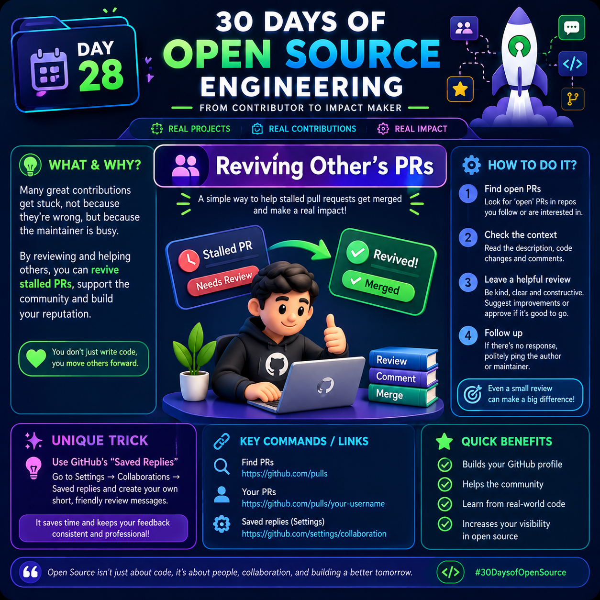

# Day 28: Reviewing Other People's Pull Requests (PRs) 

  

## What Is Reviewing Other People's Pull Requests?

A Pull Request (PR) is a way for a developer to propose changes to a codebase and ask other contributors to review those changes before they are merged into the main project.

Reviewing other people's PRs means reading their code, understanding their changes, identifying potential bugs, checking code quality, and providing helpful feedback. It is one of the most valuable ways to contribute to open-source projects, even if you are not writing new code yourself.

## Why Is PR Reviewing Important?

Many good contributions remain unfinished because maintainers are busy managing issues, reviewing code, fixing bugs, and maintaining the project. A thoughtful review can help move a stalled PR forward.

By reviewing other contributors' work, you can:

- Help identify bugs before code is merged.
- Improve code readability and maintainability.
- Check whether the changes meet the project's requirements.
- Help contributors learn better coding practices.
- Reduce the workload of project maintainers.
- Build your technical skills and open-source reputation.
- Become a more active and trusted member of the developer community.

**Remember:** You do not need to be a project maintainer to provide useful feedback. Always follow the project's contribution guidelines and respect its review process.

## How to Review Someone Else's Pull Request: Step by Step

### Step 1: Find an Open Pull Request

Visit a GitHub repository that interests you and open its Pull Requests section.

You can browse open pull requests here:

https://github.com/pulls

Choose a PR that matches your technical knowledge and interests. Beginners can start with small documentation updates, bug fixes, tests, or simple improvements.

### Step 2: Understand the Purpose of the PR

Before reviewing the code, read the PR description carefully.

Check:
- What problem is the contributor trying to solve?
- Why are these changes necessary?
- Is the PR linked to an existing issue?
- What behavior is expected after the change?
- Are there any screenshots, test results, or reproduction steps?

Understanding the goal helps you decide whether the proposed changes actually solve the problem.

### Step 3: Read the Code Changes

Open the **Files changed** tab on GitHub.

Review the modifications line by line. Pay attention to:

- Logic errors and edge cases.
- Missing input validation.
- Incorrect assumptions about data.
- Unnecessary complexity or duplicated code.
- Naming conventions and readability.
- Missing or inadequate tests.
- Potential security problems.
- Unintended changes outside the PR's scope.

Do not suggest changes simply because you would write the code differently. Focus on correctness, maintainability, security, and the project's established conventions.

### Step 4: Test the Changes When Possible

If you have the time and the appropriate development environment, test the proposed changes locally.

A typical workflow is:

1. Read the repository's contribution guide.
2. Fetch the pull request branch or check it out using the project's recommended method.
3. Install dependencies using the documented instructions.
4. Run relevant tests and linters.
5. Reproduce the original problem, if applicable.
6. Check whether the proposed changes fix it without introducing regressions.

Never run unfamiliar code blindly. Review potentially unsafe scripts and dependencies before executing them.

### Step 5: Leave Helpful and Respectful Feedback

If you identify a problem, explain it clearly and suggest a practical improvement.

**Example of unhelpful feedback:**

"This code is wrong. Fix it."

**Example of helpful feedback:**

"Could we handle the empty input case here? If this function receives an empty list, it may return an unexpected result. Adding a guard clause and a test for this scenario could make the behavior more reliable."

Good review comments explain the issue, why it matters, and how the contributor might address it.

### Step 6: Approve or Request Changes When Appropriate

Depending on your permissions and the project's workflow, GitHub may let you submit a review with options such as:

- **Approve:** The changes look good based on your review.
- **Request changes:** You found issues that should be addressed before merging.
- **Comment:** You want to share observations without formally approving or blocking the PR.

Choose the option that accurately reflects your review. Do not approve code you have not reviewed adequately, and remember that project-specific rules may determine who can approve or merge a PR.

### Step 7: Follow Up

If the author responds to your feedback, review the updated code and check whether the concern has been resolved.

If a PR remains inactive, you can leave a polite follow-up comment when appropriate. Avoid repeatedly tagging the author or pressuring maintainers.

Your goal is to help the project move forward, not to rush contributors.

## Unique Practical Trick: Build a Personal Review Checklist

Instead of reviewing every PR from scratch, create a reusable checklist that helps you catch common issues consistently.

For example:

- [ ] Does the change solve the stated problem?
- [ ] Are edge cases handled?
- [ ] Are inputs validated where necessary?
- [ ] Are tests added or updated where appropriate?
- [ ] Could the change break existing functionality?
- [ ] Are security and privacy implications considered?
- [ ] Is the code understandable and consistent with project conventions?
- [ ] Are my review comments specific, respectful, and actionable?

**Extra tip:** Keep a small collection of your most useful review questions or feedback templates. Reuse them as starting points, but always adapt them to the actual code. This saves time without making your reviews generic.

## GitHub Tip: Use Saved Replies

GitHub offers a Saved Replies feature that lets you reuse frequently used review comments.

You can find it in your GitHub settings under the collaboration-related settings, or consult the official documentation:

https://docs.github.com/en

For example, you might save a comment such as:

"Could you add a test for this edge case? It would help ensure this behavior remains correct in future changes."

Use saved replies to save time, but personalize each comment so that it accurately describes the issue in the current PR.

## Useful GitHub Links

- Find pull requests: https://github.com/pulls
- Explore repositories: https://github.com/explore
- View your pull requests: https://github.com/pulls
- GitHub review documentation: https://docs.github.com/en/pull-requests/collaborating-with-pull-requests/reviewing-changes-in-pull-requests

## Common Mistakes to Avoid

- Reviewing code without understanding the PR's purpose.
- Criticizing the author instead of explaining the technical issue.
- Requesting unrelated refactoring.
- Ignoring tests, edge cases, or security implications.
- Approving code without sufficient review.
- Leaving vague comments such as "Improve this."
- Repeatedly asking for updates when the author has not responded.
- Assuming every open PR is abandoned or needs your intervention.

## Benefits of Reviewing Other People's PRs

**For your technical growth:**
- Learn how experienced developers structure code.
- Discover new tools, patterns, and testing techniques.
- Improve debugging and code-reading skills.
- Understand how real-world software projects operate.

**For your open-source journey:**
- Help maintainers and contributors.
- Build meaningful relationships within developer communities.
- Demonstrate collaboration and communication skills.
- Develop a stronger public contribution history.

Remember that the quality of your contributions matters more than the number of comments you leave. A few thoughtful, technically sound reviews are more valuable than many superficial ones.

## Your Day 28 Challenge

Today, choose one open-source repository that interests you.

1. Find an open PR.
2. Read its description and linked issue.
3. Review the changed files.
4. Identify at least one thing you learned.
5. If you find a genuine improvement, leave one constructive and respectful comment.
6. Revisit the PR later to learn how the author responds.

If you do not find a problem, that is completely fine. You can still learn from the implementation and understand how experienced developers collaborate.

## Final Takeaway

Reviewing other people's pull requests is not just about finding mistakes. It is about helping developers improve their code, protecting project quality, sharing knowledge, and keeping open-source projects moving forward.

**You do not have to write every line of code to make a meaningful contribution. Sometimes, the most valuable contribution is helping someone else's code become better.**

#30DaysOfOpenSource #OpenSource #GitHub #CodeReview #PullRequests #SoftwareEngineering #DeveloperCommunity
