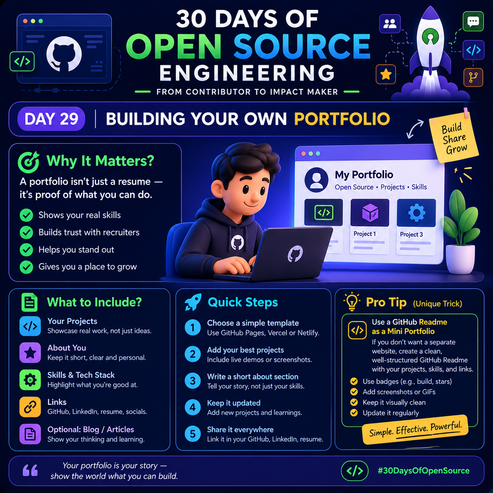

# 🚀 Day 29: Building Your Own Portfolio | 30 Days of Open Source Engineering

  

A portfolio is more than just a resume — it is proof of what you can build, what you have learned, and how you contribute to the developer community.

## 🎯 Why Does a Portfolio Matter?

- ✅ Show your real skills through practical projects.
- ✅ Build trust with recruiters and other developers.
- ✅ Stand out by demonstrating your work.
- ✅ Track your growth as a developer.
- ✅ Showcase your open-source contributions.

## 🛠️ What Should Your Portfolio Include?

### 1. Your Projects
Showcase your best projects with a short description, technologies used, and links to the source code or live demo.

### 2. About You
Write a short introduction explaining who you are, what you do, and what you are learning.

### 3. Skills & Tech Stack
Highlight the programming languages, frameworks, and tools you can confidently use.

### 4. Important Links
Include your GitHub profile, LinkedIn profile, resume, and personal website if available.

### 5. Blogs and Articles
Optionally, share technical articles, tutorials, or lessons learned from your projects.

## ⚡ Quick Steps to Build Your Portfolio

1. Choose a simple template or create a basic website.
2. Add your best projects with clear explanations.
3. Include screenshots, GIFs, or live demos where useful.
4. Write a short and personal About section.
5. Keep your portfolio updated as you learn and build.

**Free hosting options:** GitHub Pages, Vercel, and Netlify.

## 💡 Pro Tip: Turn Your GitHub README into a Mini Portfolio

You don't need a separate website to start showcasing your work!

Create a special GitHub repository with the same username as your GitHub account. Add a profile README containing:

- 👋 A short introduction
- 🧰 Your skills and tools
- 🚀 Your best projects with repository links
- 🤝 Your open-source contributions
- 📫 Ways to contact you

**Make it more useful:** Add a project status label such as `Learning`, `In Progress`, or `Completed` to help visitors understand each project's current stage.

Keep the README clean, easy to scan, and focused on real work rather than decorative badges alone.

## 🌱 Your Day 29 Challenge

- [ ] Select your three best projects.
- [ ] Write a short description for each project.
- [ ] Add links to your code and live demos, if available.
- [ ] Update your GitHub profile README.
- [ ] Share your portfolio with the developer community.

## 🏆 Final Thought

Your portfolio is your story — show the world what you can build.

#30DaysOfOpenSource #OpenSource #GitHub #DeveloperPortfolio #WebDevelopment #BuildInPublic
