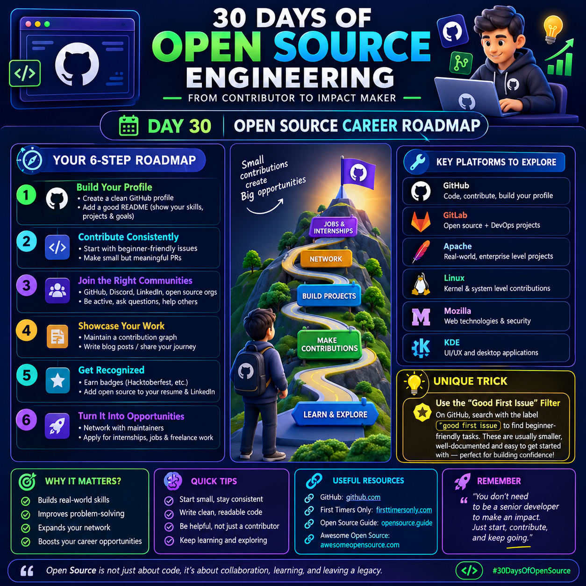

#  Day 30: Open Source Career Roadmap

  

## 30 Days of Open Source Engineering

Open source is more than writing code. It is about collaborating with developers, solving real-world problems, building a portfolio, and creating career opportunities.

## 🗺️ Your 6-Step Career Roadmap

### 1. Build Your Profile
- Create a professional GitHub profile.
- Write a clear README explaining your skills, projects, and goals.
- Pin your best repositories to your profile.

### 2. Contribute Consistently
- Start with beginner-friendly issues.
- Read the project's `CONTRIBUTING.md` file.
- Make small but meaningful pull requests.
- Learn from code reviews and maintainer feedback.

### 3. Join the Right Communities
- Participate in GitHub Discussions and relevant developer communities.
- Ask clear questions and help other contributors.
- Follow project guidelines and communicate respectfully.

### 4. Showcase Your Work
- Keep your repositories organized and documented.
- Explain your contributions in your portfolio.
- Share what you learned through technical blogs or posts.
- Focus on the quality and impact of your work, not just the number of contributions.

### 5. Get Recognized
- Build trust by making reliable contributions.
- Respond professionally to feedback.
- Participate in community events such as Hacktoberfest when available.
- Add meaningful open-source work to your resume and LinkedIn profile.

### 6. Turn It Into Opportunities
- Connect with maintainers and other developers.
- Apply for internships, developer roles, and relevant freelance projects.
- Use your contributions to demonstrate practical skills during interviews.
- Remember that contributions can strengthen your profile, but they do not guarantee a job.

## 🌐 Key Platforms to Explore

- **GitHub:** Code hosting, collaboration, and pull requests.
- **GitLab:** Open-source projects, collaboration, and DevOps workflows.
- **Apache Software Foundation:** Explore projects across many technologies.
- **Linux:** Learn about operating systems and contribute to relevant projects.
- **Mozilla:** Explore web technologies, browsers, and related projects.
- **KDE:** Discover desktop applications, UI, and user-experience projects.

Choose a project that matches your interests and skills. Always check its contribution guidelines before starting.

## 💡 Unique Practical Trick: The Good First Issue Filter

Instead of randomly choosing a repository, search GitHub for beginner-friendly issues.

1. Open GitHub and search for `good first issue`.
2. Add a technology keyword, such as Python, JavaScript, or Selenium.
3. Select an issue that matches your current skill level.
4. Read the issue description, repository documentation, and contribution guidelines.
5. Comment politely if the project expects contributors to claim or discuss issues first.
6. Make a focused change, test it, and submit a clear pull request.

**Why this works:** It narrows your search to issues that maintainers have identified as suitable for newcomers. However, the label does not guarantee that an issue is easy, available, or actively maintained.

## 🎯 Why Open Source Matters

- Builds practical development skills.
- Improves problem-solving and debugging.
- Teaches collaboration and code review.
- Expands your professional network.
- Gives you real work to discuss in interviews.
- Helps you demonstrate initiative and continuous learning.

## ⚡ Quick Tips

- Start small and stay consistent.
- Write readable, maintainable code.
- Read existing code before making changes.
- Be helpful, respectful, and open to feedback.
- Never make contributions just to increase your contribution count.
- Keep learning and exploring.

## 🔗 Useful Resources

- GitHub: https://github.com
- First Timers Only: https://www.firsttimersonly.com
- Open Source Guide: https://opensource.guide
- Awesome Open Source: https://awesomeopensource.com

Check each resource for its current availability and guidance.

## 🏁 Your First 7-Day Action Plan

- **Day 1:** Set up or improve your GitHub profile.
- **Day 2:** Choose one project related to your interests.
- **Day 3:** Read its README and contribution guidelines.
- **Day 4:** Find one suitable beginner-friendly issue.
- **Day 5:** Understand the code and reproduce the issue.
- **Day 6:** Implement a small fix or improvement and test it.
- **Day 7:** Submit a pull request if ready, or document what you learned and plan your next step.

## 🌟 Final Message

You do not need to be a senior developer to start contributing to open source.

Start with one issue, make one useful contribution, learn from feedback, and keep improving.

**Small contributions can lead to meaningful skills, stronger connections, and new career opportunities.**

#30DaysOfOpenSource #OpenSource #GitHub #SoftwareDevelopment #DeveloperCareer
